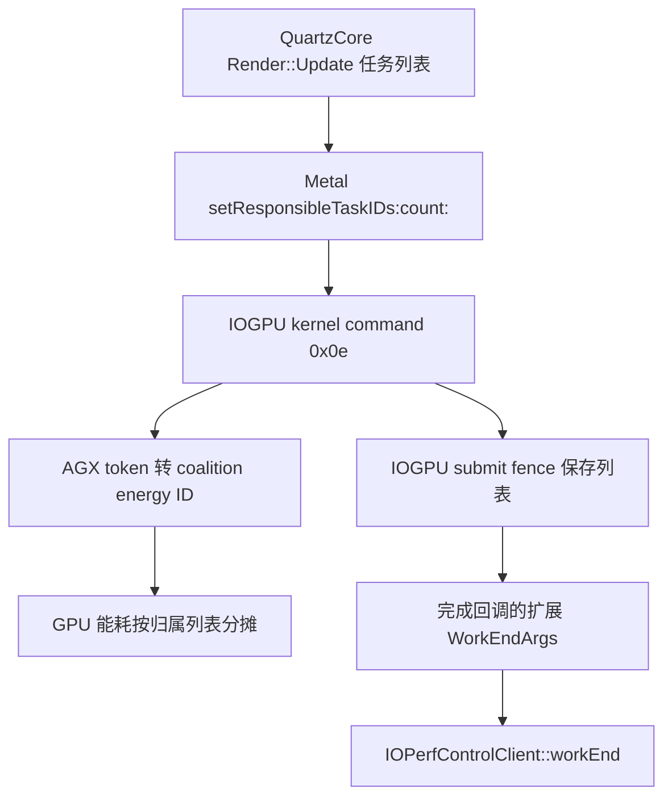

# iOS 26 Metal 任务归属接口与原生内核消费

## 1. 版本与分析范围

调查由独立 CARenderer 探针的 `setResponsibleTaskIDs:count:` 异常触发。运行过程见[真机及 QEMU 记录](../progress/2026-10-27-ios26-k90.md#10-task-identity-token-的实际输入与支持范围)。系统为 iPhone18,3／V57AP 的 iOS 26.6.2（23G90），当前移植内核为 `xnu-12377.121.6`。原版 kernelcache 的实际版本为 `xnu-12377.162.14~4/RELEASE_ARM64_T8150`；下述原版地址来自该二进制，开源源码使用 12377.121.6 逐逻辑对照，两个小版本分开记录。

从固定 Apple IPSW 的 `kernelcache.release.v57` 条目范围读取，共请求 22,104,938 字节，条目长度 22,036,069 字节，SHA-256 为 `ca27ef86c6153f2dc1639fbdb7713ae3fef66b90f8466ac73fa4f6c6a4ce1da7`，SHA-384 与现有 BuildManifest 一致。每次请求校验 HTTP 206 和 Content-Range。IM4P 解压后的 Mach-O fileset 为 72,712,192 字节，SHA-256 为 `a17cd978b8c20c5a1099d2bbd5a142e5cbc80f36fc85a6676d4b7fa9ea7d6165`。下载输入、组件 UUID、源码哈希和反汇编均保存在忽略目录 `hackios-xnu-kernel/out/ios26-resume/iogpu-kernel-contract/`。

## 2. 用户态接口与两条内核消费路径

23G90 方法编码为 `v28@0:8r^I16I24`，对应 `const uint32_t *ids, uint32_t count`。远端 Context 的 token 经注册消息保存到 Context，再进入 Render::Update 的去重列表。Apple command buffer 实现立即复制这些数值，原调用者仍负责端口生命周期。命令格式为 opcode `0x0e`、字节数、count，共 12 字节头部，后接 32 位列表。NULL 指针按零数量处理；零数量仍编码头部。

IOGPUFamily 的 `IOGPUCommandQueue::processKernelCommand` 位于原版 `0xfffffe0009c1ed60`。opcode 14 分支检查长度，以 64 位计算参数区的 `4 + count*4`；零数量直接返回，已有列表保持原样。非空列表逐项加入 submit fence，累计上限 1024 项，不去重也不验证端口。达到上限会设置队列错误。fence 释放时释放列表；完成回调把列表和实际数量写入扩展 WorkEndArgs，再调用 `IOPerfControlClient::workEnd`。CLPC GPU workEnd 对扩展字段的处理见第 5 节；其它控制器和设备分支未覆盖。

AGXG18P 也解析同一命令，并把 token name 转换为 coalition energy ID。后续 GPU 能耗记录有归属列表时按数量分摊，并调用 `energy_id_report_energy` 记录代其它任务执行的能耗；无列表时记录自身。AGX 随后仍转发命令给 IOGPUFamily，因此能耗分摊和 submit-fence 的性能控制参数两条路径都存在。opcode 14 的上述处理没有修改绘制或等待命令，性能控制回调对后续策略的影响仍需单独分析。

## 3. 名称空间和无效 token

原版 `task_id_token_to_energy_id` 经 `port_name_to_task_id_token` 查询 `current_space()` 中的 send right，使用当前提交处理线程所属任务的 IPC space。NULL、DEAD 或无法解析的名称得到转换失败；AGX 将该项 energy ID 设为 0，保留条目并继续，不将转换失败设为队列错误。后续 energy ID 0 使用自身能耗分支。IOGPU submit-fence 列表继续保存原数值，未在该层验证端口。

最初的严格自身验证候选使用 `task_identity_token_get_task_port(..., TASK_FLAVOR_NAME, ...)` 和 `mach_task_is_self`，并立即释放临时 task-name 端口。CA 的 count=1 输入返回 `MACH_SEND_INVALID_DEST`，尚未执行自身比较。该返回值不足以区分 MIG 接口缺项、无效端口或错误名称空间。

后续对照先在同一 23G90 客体自行创建 token，再完成类型查询、取得 task-name、自身比较和两次端口释放；所有返回均成功，类型为 send right。原 CA 输入分类为 `null=1, dead=0`，端口类型查询返回 `KERN_INVALID_NAME`。这两项检查确认当前失败由 CA 本地上下文的 NULL 占位触发。日志只保留分类、数量和返回码，未输出端口数值。

## 4. 当前兼容实现与验收边界

当前候选接受 NULL／DEAD 无归属占位，其余元素仍通过真实 Mach 接口验证为自身任务，外部任务及无法解析的非占位名称继续拒绝。它保持借用原 token，逐项释放临时 task-name 端口，不保存没有消费者的列表。日志区分 `self_verified` 与 `unassigned`，NULL 接受不会计为自身身份验证。

QEMU 已通过 NULL 占位处理，随后在软件着色器编译处失败，尚无像素验收结果。该范围只用于继续验收单进程原生绘制。RedwoodGPU／Mesa 当前没有跨任务 token 提交、coalition 能耗分摊和 IOPerfControl 扩展参数记录；自身身份验证也未实现原生 fence 的累计上限及全部处理语义。主机检查、QEMU 图层绘制、K90 A830 绘制、跨进程桌面和能耗归属分别验收。20F66 与 23G90 的实际系统库导出均包含上述 Mach API，既有 iOS 16.5 冻结产物保持不变。

## 5. 与 CLPC 路线的关系

原版 AppleT8150CLPC 初始化同时注册 IOPerfControl v4 回调表和 sched_perfcontrol v10 表。IOPerfControl 的 workSubmit、workBegin、workEnd 先检查 CLPC 启用状态，再按设备类型分派；GPU 分支对应 PerfDeviceID 数值 5。相关二进制、字段和反汇编在同一忽略目录的 `clpc-findings.md`、`clpc-callback-map.json` 中记录。

GPU workEnd 不读取扩展 WorkEndArgs 中的 task-ID 数组及 count，只读取 offset `0x103c` 的 uint32 比例并除以 100，args 为 NULL 时取 1.0。比例由 IOGPU 生成：AGX 命令子类型 3 增加 A，子类型 1 或 2 增加 B，结果为 `A+B != 0 ? (100*A)/(A+B) : 0`。该字段表示命令类型构成；三种子类型的正式名称尚未确认，硬件忙碌率需要另行测量。AGX 的 coalition 能耗分摊独立消费前述任务列表。

GPU workBegin／workEnd 成对更新 thread-group 的活动数量、时点和累计工作时间，部分分支累加 `elapsed * active_count`。128 位原子状态的一部分使用低 10 位计数、其余 54 位保存时点；时点保持单调，负差值按零处理。计时函数读取硬件时间寄存器并加 per-CPU timebase offset，当前只按 tick 记录，未转换为毫秒或作为纯 GPU 执行耗时。workEnd 把上述权重传给后续工作状态更新；分类字段、采样窗口与频率决策的完整关系继续分析。

同一次初始化注册的调度表中，`work_interval_notify` 入口为原版 `0xfffffe00093bfb24`，后续调用 `0xfffffe000939ce7c`；`work_interval_ctl` 入口为 `0xfffffe00093bfd68`，后续调用 `0xfffffe000939d12c`。这些位置提供了沿工作间隔输入追踪状态更新的起点。尚未取得可移植的频率映射、升降档阈值和热限制逻辑；`thermalmonitord` 及温度输入也未包含在本轮函数分析中。

后续按[路线图第 5.4 节](../plan/2026-10-26-roadmap.md#54-苹果原生策略分析与复刻clpc)继续，保留 K90 现有 SCMI／GMU 负载调频及温控作为对照。原生能耗分摊接口的确认不能直接给出 K90 的功耗数值；仍需明确可测计数、单位与时间范围。
