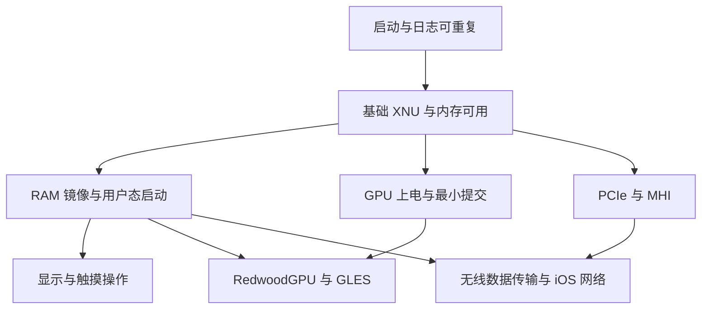

# K90 后续开发进度评估与实施指导

评估日期：2026-10-23。适用目标：HackiOS 在 REDMI K90（SM8750，annibale）上以 RAM 模式启动 iOS，并逐步验证图形、触摸和外设。本文供后续实现与集成任务使用；已发现的代码缺陷及处置状态见[独立评估报告](../analysis/2026-10-23-independent-review.md)。

## 1. 当前判断与优先顺序

项目已经具备可重复的 QEMU 用户态启动、内核构建、Mesa 交叉构建和多项板级驱动代码。当前最大的进度限制是 K90 上尚缺可重复的阶段日志和启动结果。GPU、PCIe、触摸等代码已经可以进入分阶段验证，但几条硬件路径都积累了尚待真机确认的参数。继续增加后续功能代码，会同时扩大调试范围。

建议把下一个可交付目标定为：**固定一组构建产物，在 K90 上重复完成 loader → XNU → RAM 根文件系统 → iOS 显示，并能通过触摸完成一次明确操作。** 锁屏可以先作为中间验收；桌面和触摸随后分别验收。GPU 加速与 Wi-Fi 各自保留准备任务，在基础内核和日志可用后独立推进。

近期任务按以下顺序安排：

1. 集成负责人固定设备轮输入，启动负责人取得可回收的阶段日志，确认失败发生在哪个边界。
2. 先验证最小 XNU 执行和返回，再验证完整 RAM 镜像装载、挂载与用户态启动。
3. 显示与触摸分别取得 K90 结果，随后联合验证；按键、振动、电池、手电逐项加入。
4. GPU 负责人先补齐固件入镜像与检查，再验证上电步骤；后续独立安排 CP 命令提交、完成通知和用户态服务。
5. Wi-Fi 负责人先验证 PCIe 冷启动与 MHI 前置条件，再选择数据面复用范围；相机先取得板级资料，音频维持后置。

本轮主要读取的提交为顶层 `e01885e`、kernel `c04ee9a`、userland `ada594f`；交付前顶层已推进至 `a8cdfec`、kernel 至 `f777fca`，新增进展包括 host `qmi-test` 拆分与已有文档修订。工作区存在其他任务正在修改的文件，以下结论对应读取时的文件内容；最终设备轮需要重新记录实际提交和产物哈希。本文的新增实验仅为本地镜像只读检查，未进行新的真机启动。

后续任务的依赖关系如下。GPU 和无线的内核验证可在基础执行环境成立后推进；它们进入 iOS 应用时，再与用户态启动任务联合验收。



## 2. 进度应该按功能验收记录

| 方向 | 当前已完成范围 | 尚缺的决定性结果 | 下一个可验收任务 |
|---|---|---|---|
| 构建与 QEMU | 自建内核可启动到 SpringBoard；Mesa 26.2.5 的宿主和 iOS 构建已有产物；此前独立复验过 QEMU 启动 | 相同输入在 K90 上运行到具体阶段的日志 | 固定设备轮产物，输出构建清单与最小启动日志 |
| K90 loader 与传输 | 有 annibale 平台、UEFI 构建、USB 协议调用和 `rdfile` 装载代码 | USB 命令可靠往返、内核入口确认、完整镜像可靠送入 RAM | 一条小命令往返或等效日志回收，然后逐步扩大装载量 |
| 显示 | 有 BootArgs.video 和 LK splash 地址传递方案；面板 XML 已准备 | 实际几何、stride、格式、扫描输出持续有效，XNU 绘制结果可见 | 固定色块或图案可见，再进锁屏 |
| 触摸 | `touchscreen=2` 的 annibale 参数化已实现 | 供电与 SPI 事务、报文格式、坐标范围、抬手状态在 K90 上成立 | 原始触点与手势轨迹，再完成一次 UI 操作 |
| 按键、振动、电池、手电 | `annibale_*` 驱动已实现并进入构建 | 每项外设的真实输入、读数或动作，以及退出后的状态 | 单项有限时长自检，逐项加入启动配置 |
| GPU | `adreno8` 的 16 步上电、GMU/HFI 探测代码已实现；gen8 固件已存入仓库 | 本机逐步运行结果；CP 提交、GPU 内存管理、fence、RedwoodGPU 后端；实际 GLES 输出 | 固件可被镜像读取，然后逐步取得 GMU/HFI 状态 |
| Mesa 与 Metal | 新 Mesa/AIR 构建、导出接口和部分 CPU 路径检查已完成 | a830 执行命令、shader 数值正确、CoreAnimation 使用该路径 | 最小 GLES 离屏绘制与读回，明确实际 renderer 和提交结果 |
| Wi-Fi | PCIe 三步勘察代码、资源调查和固件来源已准备 | PCIe 主动初始化、DMA/MSI、MHI 主机、固件启动、QMI/WLFW、无线数据面 | 冷启动及重启后的 PCIe link、设备 ID、BAR 和 MHI 状态 |
| 相机 | CAMSS 与传感器连接关系已有调研，redwood 用户态路径可供复用 | 本机 sensor 身份与初始化表、CPAS/时钟/SMMU、TPG 和真实 RAW 帧 | 取得 vendor 资源并核对，确定一条最小取帧路径 |

依据：[离线进度记录](../progress/2026-10-23-offline-prep.md)、[真机试验记录](../progress/2026-10-23-annibale-device-trials.md)、[总体规划](porting-plan.md)，以及下文所列实现。QEMU 中关闭新硬件功能后的启动结果，只覆盖默认配置的兼容性；设备验收需要启用相应功能并检查输出。

建议任务状态至少分开记录：代码已实现、构建成功、宿主或 QEMU 验证、K90 验证。`task-4 completed` 的有效范围是 16 步探测代码交付；下一阶段继续使用具体功能名称，便于看清剩余工作。当前不宜按提交数量或文件数量估算整体完成百分比。

## 3. 首要任务是让每次真机试验能回答一个问题

### 3.1 启动与日志需要独立验收

目前记录中的静默循环，使内核、显示、外设和传输的故障难以区分。下一轮应先使用已批准的启动与恢复方式，选择一个最小变体，固定关闭尚未验收的外设。loader、XNU 入口、虚拟盘就绪、用户态启动各留一个能够识别本次构建的标记。屏幕和 USB 任一条可以提供结果；若只取得枚举状态或设备消失，只记录这一观察。

USB 排查可以直接围绕现有 `usb_start()`、`usb_wait()` 和命令轮询展开：记录协议定位与 `StartEx` 返回值、`handle_event` 返回状态、事件类型与长度、连接状态转换、OUT 请求排队结果、传输完成端点和字节数。第一步只要求一个短命令往返，再检查小块数据与校验值；成功后再扩大到系统镜像。源文件：[loader.c](../../hackios-xnu-kernel/xnuloader/loader.c)、[efi.h](../../hackios-xnu-kernel/xnuloader/efi.h)。

这里尚未确定 USB 根因。修改协议结构体、调用约定或事件参数前，应对照实际链接的 Qcom 协议头和实现版本。不能仅凭另一种 UEFI USB 协议的接口形式替换参数。若日志说明尚未收到连接事件，先调查事件来源；若已排队而无完成，再调查端点和传输。每次新增的信息应能缩小下一轮修改范围。

**完成标准：** 同一组产物能重复取得阶段标记；能指出最后成功阶段和下一阶段的返回值或现象；失败后可按既有恢复流程继续试验。建议至少完成一次正常启动与一次失败后的重试，再进入多外设联合测试。

### 3.2 最小 XNU 执行与完整 iOS 启动分开

首次确认内核可执行时，优先使用现有最小探测、日志和返回能力，确认平台参数、GIC、计时与必要内存映射。SMP、GPU 和无线驱动随后分别启用。若现有入口允许单核执行，可先限制变量；无需为此先设计另一套启动框架。

完整启动再依次确认：镜像在 RAM 中的位置与长度正确、虚拟盘能够读到预期文件系统、根文件系统挂载、`launchd` 启动、图形进程启动。现有 `rdfile` 路线以及上一份报告中已安排的相关修复，属于这一阶段的输入条件。传输来源涉及额外分区写入时，仍按已有用户限制和处置流程执行；本文不新增设备写入授权。

**可能卡点：** 平台识别、缓存与内存属性、GIC/定时器、镜像驻留区与系统保留区的关系、启动后服务依赖。首轮定位到某个边界后才扩展对应模块；一次只改变一个能解释观察结果的因素。

### 3.3 显示和触摸先各自成功，再联合

BootArgs.video 传递方案可以减少首轮显示驱动工作，但需要确认 LK 留下的扫描输出在进入 XNU 后仍持续工作。下一步先输出能识别边界、颜色与行步长的静态图案，同时记录物理地址、宽高、stride 和像素格式。随后验证锁屏与桌面。若静态图案都不可见，应先检查显示状态和缓冲几何，用户态重装的收益有限。

触摸先输出按下、移动、抬起的原始数据，核对中断极性、SPI 报文、最大坐标和旋转，再验证 iOS 注入。建议验收动作固定为解锁或打开设置后返回，记录实际手势与 UI 反应。不同外设共用的 SPMI 锁、RPMh 资源与初始化顺序，应在单项成功后再联合检查。实现入口见 [redwood_goodix.c](../../hackios-xnu-kernel/xnu/files/bsd/dev/redwood_goodix.c) 与 [redwood_audio.c](../../hackios-xnu-kernel/xnu/files/bsd/dev/redwood_audio.c)。

## 4. GPU 后续任务中缺少的中间阶段

### 4.1 先解决固件实际交付

`firmware-gen8/` 已有 `gen80200_gmu.bin`、`gen80200_sqe.fw`、`gen80200_aqe.fw`。当前 [build.sh](../../hackios-xnu-userland/userland/build.sh) 的固件分支只从 `../fw-gpu/` 复制文件；读取时未发现它消费 `firmware-gen8/`。驱动第 9、10 步通过 `adreno8_image_file("fw", "gen80200_gmu.bin", ...)` 查找镜像内文件，见 [adreno8_gmu.c](../../hackios-xnu-kernel/xnu/files/bsd/dev/adreno8_gmu.c)。

本轮只读检查确认：`hackios-xnu-kernel/userland/root.apfs` 的根目录没有 `fw`，查询 `/fw/gen80200_gmu.bin` 返回 `no such path`。检查对象 SHA-256 为 `cc746d976053e6580f096410fd3192f0cd3f8a3c7977e97142472c16bfb28a46`；仓库内 GMU 文件 SHA-256 为 `5e83d869c4039db7a11d1ee6e013c5a795f51daf6372ad9ed2fecc9b26dee910`。该结果可以通过项目 APFS 读取工具对同一镜像执行 `ls IMAGE /` 与 `stat IMAGE /fw/gen80200_gmu.bin` 复查。

**下一任务：** 由构建负责人把选定固件纳入 annibale 的镜像装配，保留来源、版本、许可与哈希，再从最终 `root.apfs` 读出并比较字节。驱动注释中关于固件已进入镜像的描述随实现同步校正。第 9 步所需文件就绪后，才安排该步真机试验。SQE/AQE 属于后续 CP 初始化输入，可以一并记录，但验收时按实际使用范围区分。

处理难度低，修改风险低到中；主要风险来自构建目录与设备选择条件误用。只需补充现有装配和检查，不需要引入新的固件管理服务。

### 4.2 上电探测之后还需要可提交的 GPU 服务

[adreno8.c](../../hackios-xnu-kernel/xnu/files/bsd/dev/adreno8.c) 的 16 步主要覆盖 CX/GX 电源、时钟、GMU 固件、SMMU 与 HFI；文件头明确将 SQE/AQE 和 3D core 后续启动留到下一阶段。当前 [RedwoodGPU.cpp](../../hackios-xnu-kernel/xnu/files/iokit/Kernel/RedwoodGPU.cpp) 的 `ready`、`submit`、`done`、映射和恢复仍调用旧 `redwood_gpu_*` 实现。因此后续计划中必须单列命令提交与服务适配任务。

建议按以下阶段验收：

| 阶段 | 要取得的结果 | 审查重点 |
|---|---|---|
| G1 固件与 GMU | 当前镜像可读固件；逐步上电；GMU/HFI 响应；退出后状态可解释 | 电源与时钟来源、HFI 返回码、SMMU context 与 stream、失败清理 |
| G2 CP 最小提交 | CP 微码与 ring 初始化；一次最小命令写入离屏缓冲；fence 完成；CPU 读回符合预期 | gen8 寄存器与包格式、ring 指针、GPU/CPU 缓存可见性、超时与越界保护 |
| G3 RedwoodGPU 服务 | 原有用户态 ABI 可以创建、映射、提交、等待和释放 annibale 的 GPU 资源 | chip ID/参数正确、资源生命周期、进程退出时尚未完成的工作、复位后旧 fence 如何处理 |
| G4 GLES | 小型 GLES 绘制和纹理读取通过；输出实际 renderer；确认有硬件提交和完成 | 软件回退识别、像素比较、同步和 shader 正确性 |
| G5 UI 与 Metal | CoreAnimation 的代表场景和选定 Metal 测试在 K90 上通过 | 渲染内容、帧耗时、长短任务交错、失败日志、温度与持续运行 |

G2 的目标缓冲应独立于扫描输出缓冲，先验证结果和边界，再允许命令访问显示表面。G3 可在原有 ABI 后按平台选择实现，保持范围可审查；先列出已有调用者需要的操作，再决定接口形态。当前只需要两种实现的差异表达，泛化到任意 GPU 的框架会增加调试成本。

### 4.3 真机验证要覆盖未知参数和退出路径

驱动头部已列出 PLL、RCG 更新位、SMMU context 布局、stream mask、带宽表、IFPC 和 speed bin 等未确认项。每项应附对应源码或设备树依据、预期读数、实际读数和继续条件。涉及后续写入地址或 DMA 映射的关键差异，应先停止该步骤，核对布局后再继续。单次寄存器回读正确，覆盖的是这一次访问；还需检查实际执行结果与 fault 状态。

`adreno8_speed` 当前默认取所选表的最高档。建议初轮显式选择经参数核对的低档，记录实际投票与温度观察条件。使用 `adreno8_keep`、`adreno8_only` 或跳过步骤时，要记录它们依赖的先前状态；正式验收补一次从已知启动状态完整执行的结果。

清理顺序与启动同样需要审查：停止产生新工作，确认相关处理器和 DMA 已停止，处理未完成任务，再解除映射并释放内存。对 `block_stop()` 与 `quiesce()` 的验收应包含中途失败和返回 loader 后再次启动。高风险点集中在设备仍可访问的缓冲和页表，不能只检查释放函数是否被调用。

最小诊断输出可参考 Linux 的 [MSM GPU crash dump 文档](https://docs.kernel.org/gpu/msm-crash-dump.html)：GPU 版本、ring 读写指针、最后提交及完成 fence、相关缓冲地址与大小、fault 和关键寄存器。先输出这些能解释一次失败的字段，无需移植整套转储基础设施。

### 4.4 图形性能与 Mesa 选型需要本机结果

现有 [GPU 计划](gpu-plan.md) 把 2D 拷贝作为较早收益点。K90 上还缺 CPU 绘制、缓冲拷贝、等待与呈现的分别计时。建议先在相同画面下测量这些部分，再确定优先做 blit 还是 GLES 渲染；QEMU 耗时只能用于对应模拟环境。

Mesa 26.2.5 构建成功、AIR 翻译成功、CPU 路径结果和 a830 硬件执行分别记录。G2/G3 通过后，先选择最小绘制和读回，再逐步扩大测试集。若出现 GLES 失败，先定位在提交、同步、指令生成还是状态设置，然后评估修复范围。

Turnip 加 GL-over-Vulkan 会新增 Vulkan 服务适配和 GL 转换层的集成工作。建议保留为备选，等取得可以定位的 gen8 Gallium 障碍后再比较成本。宿主构建失败或软件路径某项失败，适合先修对应层；这些结果尚不足以判断另一套完整图形栈的移植成本更低。

## 5. Wi-Fi 应先确定主机传输能工作

### 5.1 现有 PCIe 勘察的边界

[mhi_pcie.c](../../hackios-xnu-kernel/xnu/files/bsd/dev/mhi_pcie.c) 的 `pcie=1..3` 依次读取电源与引脚状态、检查已有 link、借用并恢复 iATU 窗口和 BAR sizing、读取 MHI 寄存器。它依赖链路已建立；当前文件没有完整的 PCIe 上电、PHY 配置和训练流程，也没有 BHI 固件下载、MHI 通道或 doorbell 工作流。

因此，若第一轮读到 link down，下一个任务应是根据本机控制器和 PHY 的来源实现最小初始化，并验证冷启动与重启。如果从 Android 重启后偶尔能够枚举，记录它对先前状态的依赖，继续检查从目标启动路径能否建立同样状态。

### 5.2 把联网拆成可以判定的阶段

| 阶段 | 完成标准 | 常见卡点与应保留的信息 |
|---|---|---|
| W1 PCIe | 从已知启动状态建立 link，读到预期设备身份和有效 BAR，重复试验结果一致 | 供电、PERST、参考时钟、PHY、LTSSM；保存修改前后值和退出状态 |
| W2 DMA 与通知 | 设备可访问限定的主机缓冲；地址宽度、缓存处理、SMMU stream 与完成通知明确 | IOVA 与物理地址混用、保留区冲突、MSI 映射；轮询方案需要明确范围与超时 |
| W3 MHI 与固件 | 固件进入预期执行状态；command、event、channel ring 能完成最小往返 | BHI/BHIE、状态转换、ring 索引与内存顺序、设备复位后的上下文重建 |
| W4 QMI/WLFW | 服务发现、版本与能力交换、板级数据选择和固件初始化成功 | BDF 匹配、QRTR 通道、消息布局、初始化顺序与超时 |
| W5 无线数据 | 扫描、关联、密钥配置、TX 完成与 RX 内容均可检查 | WMI 与 HAL ring、缓冲所有权、队列满、丢包与复位 |
| W6 iOS 联网 | 获取或配置 IP、DNS 查询、一次应用请求、断线后重新连接 | link 状态通知、接口配置、认证状态、路由与 DNS 生命周期 |

上述顺序来自本仓库当前缺口与 [Linux MHI 文档](https://docs.kernel.org/mhi/mhi.html)：MHI 使用主机内存中的 channel、event、command context 和 ring，设备通过 DMA 访问；BHI 用于固件下载。具体状态、通道和固件步骤仍需按 WCN7850 所用驱动核对。它们应成为任务书中的显式输入。

### 5.3 数据面路线先做依赖盘点，再选择

[Wi-Fi 计划](wcn7850-plan.md) 提出先手写最小 WMI 与 ring，再移植完整 ath12k。扫描、加密关联、重排序、TX/RX 缓冲和复位都会在第一条路线中形成需要维护的实现，第二条路线又需要验证与替换这些行为。建议先做一次有边界的对照：列出本仓库 LinuxKPI 已有接口、ath12k 实际调用的缺项、可直接复用的数据结构和所需平台操作，再决定保留哪一条数据面实现。

Linux Wireless 的 [ath12k 文档](https://wireless.docs.kernel.org/en/latest/en/users/drivers/ath12k.html) 将 WCN7850 hw2.0 列为支持设备，并说明 ath12k 使用 mac80211。这能提供驱动参考和协议实现来源；XNU 侧仍需处理对应依赖。离线阶段适合产出调用关系与缺项清单，过早实现两套数据面会增加后续维护工作。

固件包可取得之后，仍要确认具体芯片修订、固件接口版本、板级数据与校准信息。固件启动失败时，检查下载内容、执行状态、DMA 和板级配置，逐项缩小范围。当前没有依据把剩余原因限定为某一种权限或时序问题。

`en0` 接入可复用现有 [redwood_net.c](../../hackios-xnu-kernel/xnu/files/bsd/dev/redwood_net.c)，但要逐项核对发送缓冲生命周期、接收数据交付、线程与锁、link 状态变化和复位。现有 `net_output()` 在 `transmit()` 返回后释放 mbuf；[redwood_net.h](../../hackios-xnu-kernel/xnu/files/bsd/sys/redwood_net.h) 明确要求发送实现复制数据，接收交付也要求在非中断上下文执行。新 DMA 后端先遵守这些约定，使用自己持有的缓冲直到设备完成访问。该接口检查应安排在 W2/W5 设计时，防止联网集成后才发现缓冲所有权不兼容。

**暂停条件：** 前一阶段无法输出可解释的状态时，先完善诊断或缩小实验。连续几个设备窗口没有新增观察，可以调整任务优先级；窗口次数本身不足以确定硬件不可用。恢复推进需要写明还缺哪项资料或哪种观察手段。

## 6. 外设与相机的安排

### 6.1 已实现的小外设应尽快完成独立验证

按键、振动、电池、手电的改动范围较小，适合在基础内核可运行后逐项验收。首次不宜把所有开关同时加入唯一测试配置。一个驱动访问异常时，需要保留其他驱动已成功的配置作为对照。

| 外设 | 建议验收内容 | 后续风险 |
|---|---|---|
| 按键 | 每个实体键的按下和释放、长按、组合输入；对应 iOS 行为 | PMIC 身份、极性、去抖、重复事件与恢复操作冲突 |
| 振动 | 有限时长动作、停止、重复动作；退出后不持续驱动 | SPMI 地址、时序和波形参数；与其他 SPMI 使用者并发 |
| 电池 | 有效标志、原始值、换算值、异常值处理；能与设备已有读数交叉核对时记录差异 | 读数刷新和陈旧缓存；电量显示的验收范围仅包含读取与呈现 |
| 手电 | 低档有限时长开关、故障状态、到时关闭和退出关闭 | 电流、温度、异常路径；后续相机使用同一控制入口时的所有权 |

持续 GPU 或无线负载开始前，应有温度观察方式、限定运行时长与停止条件。电池显示正常只覆盖它自身的读取路径，充电控制、热管理和休眠恢复需要后续单列验收。当前先保证短时试验可控，无需为首个桌面提前完成完整电源管理界面。

### 6.2 相机当前优先获取板级资料

[相机计划](camera-plan.md) 已整理 CAMSS、CCI、供电和数据通路，但本机 sensor 的 chip ID、上电与模式寄存器表仍待确认。下一任务应是取得并分析对应 vendor 资源，记录文件来源与机型版本，核对 sensor 身份及一条最小输出模式。计划中的 OV50E 身份应保留为待本机资料确认的判断。

建议验收顺序为：资源与地址核对 → 供电和控制总线 → TPG 到内存 → sensor ID 与初始化 → 一帧真实 RAW 数据 → 连续取帧 → iOS 预览 → 拍照和对焦。TPG 可以隔离 sensor 初始化问题；真实相机仍需验证 CSI 时序、图像格式和曝光。

现有计划存在一处依赖矛盾：其 TPG → CSID/IFE → 内存路线使用 CPAS、时钟与 SMMU，同时又提出 CPAS 起不来时退到 TPG 内存图。按该文所述路线，CPAS 未启动会继续阻塞 TPG。这里应先验证是否存在另一条有来源的硬件通路；否则将该阶段暂停。软件生成静态图可以验证显示或用户态接收，验收范围应写成对应的软件路径。

用户态复用也需要检查 RAW stride、Bayer 排列、曝光单位、时间戳、帧缓冲所有权和停止取流。iOS 版本固定减少了一类变量，但新 sensor 与内核的接口差异仍然存在。拿到首帧前，先写接口检查清单和样本解析工具即可，完整相机 UI 调整暂缓。

音频涉及新的 ADSP 与 SoundWire 路径，当前主目标没有依赖它。建议保持后置，待可操作桌面与较稳定的开发循环成立后再安排独立调研和验收。

## 7. 建议分发给现有 agent 的下一批任务

以下是任务范围建议，可交给现有负责人；每项产出应进入原有进度记录。涉及设备的任务等待可用窗口，离线项可以先完成。

| 任务 | 负责人方向 | 本次交付与完成标准 | 依赖及边界 |
|---|---|---|---|
| A 启动定位 | loader / UEFI | 一份固定最小配置；分阶段日志方案；短命令或等效日志回收；记录最后成功阶段 | 集成负责人提供固定产物；首轮关闭待测外设；根因未定位前先缩小变量 |
| B 设备轮装配 | 集成 / 构建 | 提交、补丁状态、UEFI/DTB/loader/kernel/root/system 哈希、尺寸与启动参数在同一记录中；检查产物内部引用一致 | 与 A 配合；共享 prebuilt、root.apfs 和最终镜像由单一负责人更新 |
| C GPU 固件交付与 G1 | GPU + 构建 | 将选定固件装入镜像并读出比对；逐步检查表；真机输出 GMU/HFI 和退出状态 | 固件装配可离线完成；G1 真机依赖基础内核与日志；暂不改 MiniIMF |
| D GPU 服务与最小测试设计 | GPU / Mesa | 列出 RedwoodGPU 消费的操作与生命周期；准备一个离屏提交和 GLES 读回用例；明确硬件路径判定 | 可以先完成接口盘点；G2/G3 实现根据 G1 结果推进；维持已有用户态 ABI |
| E PCIe/MHI 下一阶段 | 无线 / 驱动 | 解释 link down 与 link up 两种结果的后续步骤；DMA/MSI/缓存与 ring 所需条件；ath12k 依赖缺项清单 | 当前勘察先取得本机结果；手写数据面与 ath12k 移植先比较范围再选择 |
| F 显示、触摸及小外设 | 板级驱动 | 静态显示、原始触点、各外设单项验收记录；成功后给出最小联合配置 | A/B 通过后进设备轮；保留每项退出与异常路径结果 |
| G 相机资料准备 | 调研 / 相机 | vendor 资源清单、sensor 身份与模式表、TPG 依赖核对、RAW 接口检查项 | 资料缺失时明确列出；完整采集实现排在本机前置条件确认后 |

共享工作区的主要协调点是构建产物：代码作者可以并行工作，设备轮集成要固定输入。建议负责人只从明确提交或明确补丁集合构建一次待测产物，并保留该版本直到本轮结果记录完毕。其他提交继续推进时，下一轮重新装配和记录。这样可以直接解释某次失败对应的代码与参数。

每个任务完成时提交以下简短记录即可：

```text
本次目标：一个可观察的行为或状态转换
输入：提交或补丁集合，配置，相关产物哈希
结果：代码已实现 / 构建成功 / 宿主或 QEMU 已验证 / K90 已验证
验证内容：实际执行命令、关键输出、测试覆盖的功能
尚未验证：具体缺少的运行条件或观察
下一步：能区分当前候选原因的一次实验
退出与恢复：本次资源、设备状态和既有恢复流程的结果
```

集成审查重点放在实际调用关系、最终镜像内容和失败清理。输出中必须区分执行过的测试与跳过项。默认关闭驱动的 QEMU 启动，记录为默认配置回归；硬件功能的完成标准使用上表的实际行为。

## 8. 难度、复杂度与修改风险

以下是基于当前实现范围的相对判断。难度指资料与调试条件的要求；复杂度指需要同时处理的模块和状态；修改风险指对启动、共享资源或现有行为的影响。它们用于安排工作与审查强度，尚不足以换算可靠交付日期。

| 工作 | 难度 | 复杂度 | 修改风险 | 可以降低不确定性的最近结果 |
|---|---|---|---|---|
| gen8 固件装配及镜像检查 | 低 | 低 | 低到中 | 最终镜像文件逐字节匹配，设备配置选择明确 |
| 设备轮输入清单与产物固定 | 低到中 | 中 | 低 | 独立按清单装配并核对一次；避免共享输出被覆盖 |
| loader USB 与启动定位 | 高 | 中到高 | 高 | 事件日志、短命令往返、最小内核阶段标记 |
| RAM 启动到用户态 | 高 | 高 | 高 | 内存布局与装载检查、挂载及 launchd 的本机结果 |
| 显示与触摸 | 中到高 | 中 | 中到高 | 实际扫描输出、触摸原始报文；失败路径能够恢复 |
| 小外设单项验收 | 中 | 低到中 | 中；错误供电参数时上升 | 有效身份、限定动作、停止与重复测试 |
| GPU G1 | 高 | 高 | 高 | 已知启动状态下 GMU/HFI 成功，SMMU 无异常，清理可重复 |
| GPU G2/G3 | 很高 | 很高 | 高 | 离屏提交、fence、CPU 读回、超时退出和重复初始化 |
| GLES/Metal 硬件集成 | 高 | 很高 | 中到高 | 最小绘制与数值读回，实际硬件路径及耗时分解 |
| PCIe/MHI | 很高 | 很高 | 高 | 冷启动 link、DMA 与通知、MHI 状态和最小传输 |
| ath12k/WMI 与 iOS 联网 | 很高 | 很高 | 高 | 依赖清单、单次 TX/RX、关联与断线恢复 |
| 相机资料整理 | 中 | 中 | 低 | 本机 sensor 与模式表可追溯、依赖核对完整 |
| CAMSS 与真实取帧 | 很高 | 很高 | 高 | TPG 与真实 RAW 分别成功、退出可重复 |

现有计划中的周数、设备窗口数和离线可完成比例适合保留为最初估计。下一次重估应使用本机结果：启动任务先得到最后成功阶段；GPU 先得到 GMU/HFI 状态；Wi-Fi 先得到冷启动 link 与 DMA 条件；相机先拿到 sensor 资料。此前各路线的关键未知仍然独立存在，多加实现人员也难以缩短串行的真机确认过程。

每轮优先审查高风险共享部分：内存分配与 DMA 生命周期、时钟和供电、SMMU、启动参数与设备身份、恢复路径。寄存器表录入和文件拆分可以采用来源逐项核对与行为比较；需要额外试验的地方集中在状态转换和设备交互。

## 9. 需要及时调整的工作方向

1. **完成状态按阶段限定。** 将 16 步 GPU 代码、PCIe 勘察、Mesa 构建分别记录，后续任务书明确缺少的功能，防止直接从当前状态安排 UI 加速或联网验收。
2. **显示仍需本机验收。** 当前进度记录已有把屏幕作为日志通道的安排；在静态图案可见之前，USB 或其他可回收日志仍有直接价值。先保留能定位失败的观察路径。
3. **联合外设配置后置。** 先单项，再联合；发生失败时保留最近一次通过的配置。这样能区分新外设问题和基础启动问题。
4. **性能优先级由计时决定。** 2D blit 可以作为命令提交验证任务；对 UI 流畅度的收益待 K90 分段计时确认，再决定投入顺序。
5. **相机退路检查依赖。** CPAS 失败时重新评估 TPG 的可行性；UI 静态图、TPG 帧、真实 sensor 帧分别验收。
6. **结构整理按已有规则控制范围。** 新文件与本次大改文件遵守 800 行约定；现有 host 工具拆分完成约定验证后即可结束该批次。大范围存量拆分、命名调整和框架建设，按对当前设备目标的实际影响再排期。
7. **失败后先增加可判定信息。** 连续试验仍只有黑屏或复位时，下一任务应改善定位或取得缺失资料。补写后续寄存器阶段，通常无法解释前一阶段为何失败。

最近一轮的建议交付是 A/B/C 的离线部分，以及 D/E 的接口和依赖清单。设备可用后，先做 A，再由结果选择最小内核、显示或传输中的一个方向继续。完成可重复启动与触摸操作后，再将 GPU 和无线分别作为独立功能验收。
